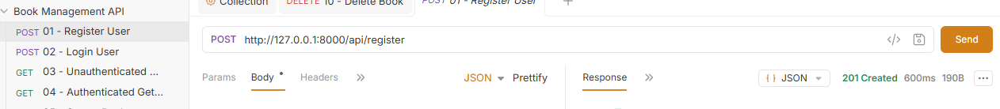
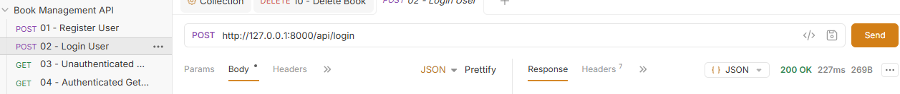
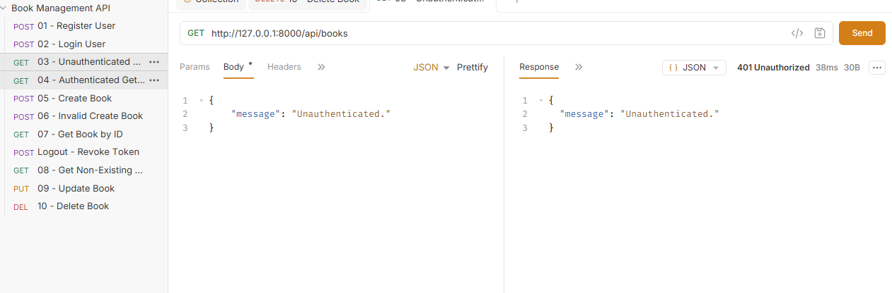
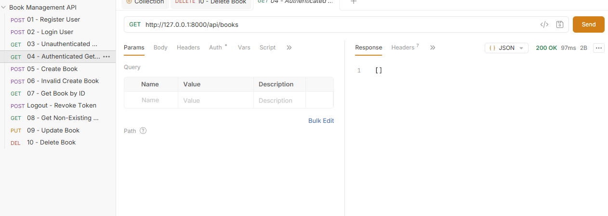
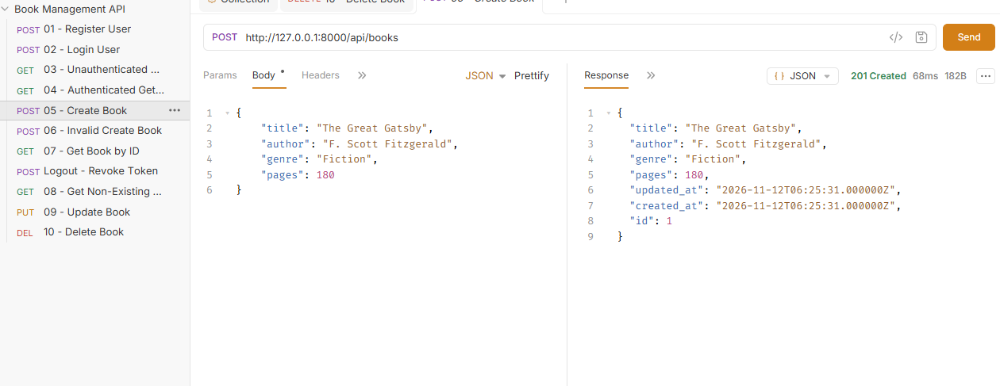
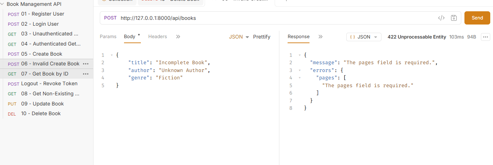
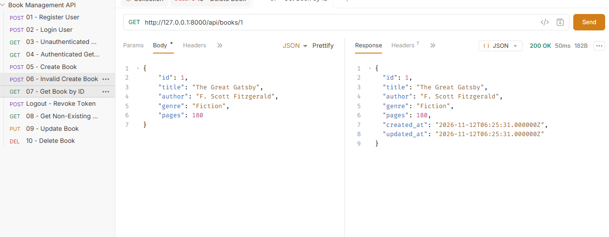
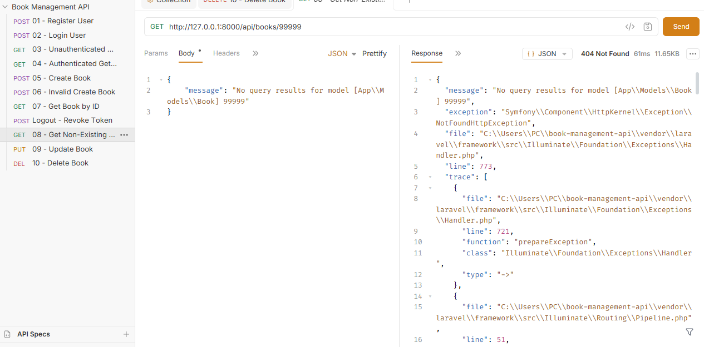
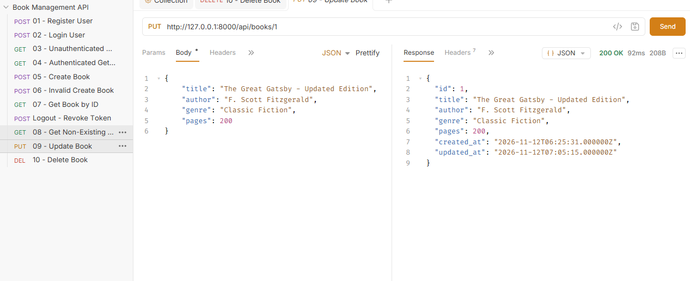
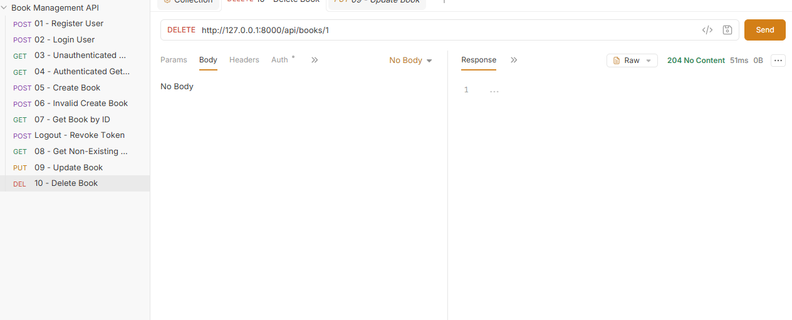

# Book Management API

**Project:** Book Management API  
**Author:** Kurt Cobain V. Estrella  
**Section:** IT-3E  
**Resource:** Book

## 1. Project Description

The Book Management API is a Laravel-based REST API that allows users to manage book records. It supports user registration, login, logout, viewing user information, and CRUD operations for books. The API uses Laravel Sanctum for authentication and SQLite as its database.

## 2. Installation and Setup

Follow these steps to run the project on your computer.

### Step 1: Clone the Repository

```bash
git clone https://github.com/Kael-23/Book-management-api.git
cd Book-management-api
```

### Step 2: Install Dependencies

```bash
composer install
```

### Step 3: Create the Environment File

```bash
copy .env.example .env
```

### Step 4: Generate the Application Key

```bash
php artisan key:generate
```

### Step 5: Set Up the SQLite Database

Make sure this file exists:

```text
database/database.sqlite
```

If it does not exist, create it using PowerShell:

```powershell
New-Item database/database.sqlite -ItemType File
```

In your `.env` file, set:

```env
DB_CONNECTION=sqlite
```

### Step 6: Run the Migrations

```bash
php artisan migrate
```

### Step 7: Start the Laravel Server

```bash
php artisan serve
```

The API will be available at:

`http://127.0.0.1:8000`

## 3. API Routes

| Method | Endpoint | Description | Authentication |
|---|---|---|---|
| POST | `/api/register` | Register a new user | Public |
| POST | `/api/login` | Log in and receive an access token | Public |
| POST | `/api/logout` | Log out the current user | Required |
| GET | `/api/me` | Get authenticated user information | Required |
| GET | `/api/books` | Retrieve all books | Required |
| POST | `/api/books` | Create a new book | Required |
| GET | `/api/books/{book}` | Retrieve a specific book | Required |
| PUT | `/api/books/{book}` | Update a book | Required |
| DELETE | `/api/books/{book}` | Delete a book | Required |

### Book Filtering

The API supports filtering books using:

- `genre` – Filter books by genre.
- `author` – Filter books by author.

Examples:

```text
GET /api/books?genre=Fiction
GET /api/books?author=F. Scott Fitzgerald
```

## 4. Bruno API Testing

The following screenshots show the results of the 10 required API tests.

### 1. Register User – 201 Created



### 2. Login User – 200 OK



### 3. Unauthenticated GET Books – 401 Unauthorized



### 4. Authenticated GET Books – 200 OK



### 5. Create Book – 201 Created



### 6. Invalid Create Book – 422 Unprocessable Content



### 7. Get Book by ID – 200 OK



### 8. Get Non-Existing Book – 404 Not Found



### 9. Update Book – 200 OK



### 10. Delete Book – 204 No Content



## 5. Why Does DELETE Return 204 Instead of 200?

The DELETE request returns **204 No Content** because the book was successfully deleted from the database. This status code means that the server completed the request successfully but does not need to send any response data. Unlike 200 OK, which can include a response body, 204 No Content is used when there is nothing else to return. This is why the response body is empty after deleting a book.

## 6. Technologies Used

- PHP
- Laravel
- Laravel Sanctum
- SQLite
- Bruno API Client
- Composer
